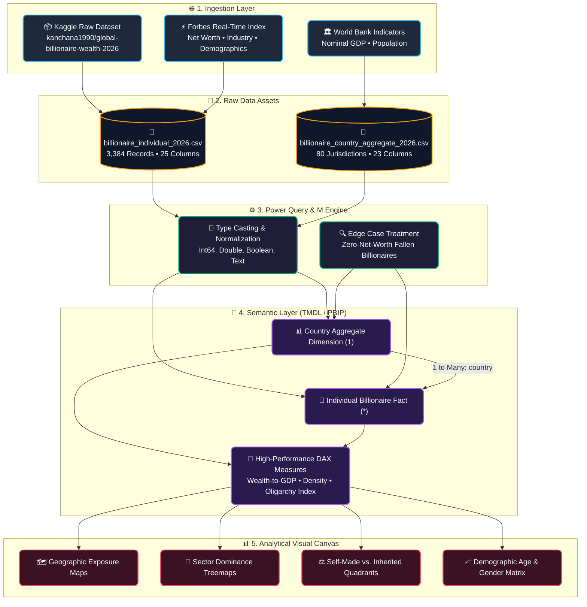
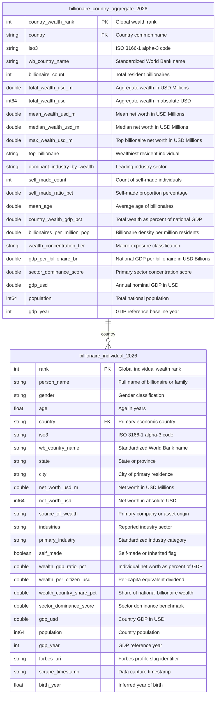
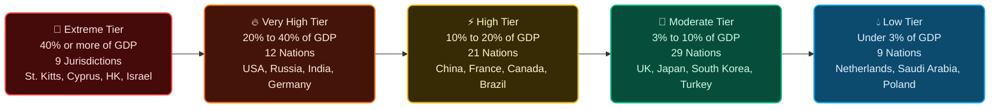
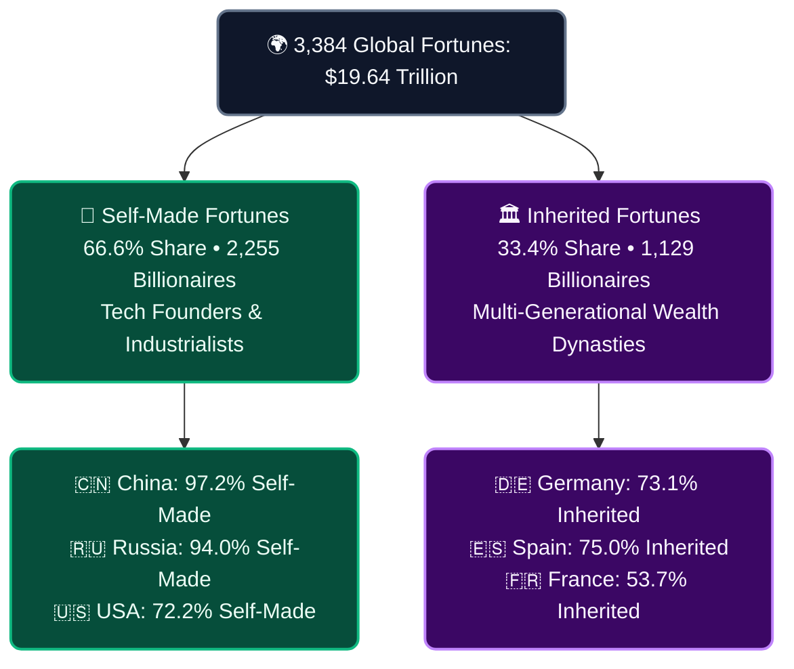

<div align="center">

# ⚡ Global Billionaire Wealth to GDP (2026)

### *High-Performance Macroeconomic Analytics & Capital Concentration Intelligence*

<p align="center">
  <a href="powerbi/Global_Billionaire_Wealth_2026.pbip">
    
  </a>
  <a href="powerbi/Global_Billionaire_Wealth_2026.SemanticModel/">
    
  </a>
  <a href="docs/business_questions.md">
    
  </a>
  <a href=".github/workflows/ci.yml">
    
  </a>
  <a href="https://www.kaggle.com/datasets/kanchana1990/global-billionaire-wealth-to-gdp-2026/data">
    
  </a>
  <a href="LICENSE">
    
  </a>
</p>

<p align="center">
  <b>A modern business intelligence and macro-financial model dissecting $19.64 Trillion in private capital across 3,384 fortunes and 80 sovereign economies.</b>
</p>

</div>

---

## ⚡ At a Glance

<div align="center">

| 💰 Cumulative Wealth | 👥 Total Fortunes | 🌍 Sovereign States | 🚀 Self-Made Ratio | 💻 Dominant Sector | 🏛️ Top Sovereign Concentration |
| :---: | :---: | :---: | :---: | :---: | :---: |
| **$19.64T** | **3,384** | **80** | **66.6%** | **Technology ($4.75T)** | **USA (29.0% GDP)** |

</div>

```
Global Capital Distribution by Top 5 Economic Powers
────────────────────────────────────────────────────────────────────────────────
🇺🇸 United States │ ████████████████████████████████████████  $8.34T  (978 Titans)
🇨🇳 China         │ ██████████                                $2.13T  (528 Titans)
🇮🇳 India         │ █████                                     $0.99T  (225 Titans)
🇩🇪 Germany       │ █████                                     $0.99T  (212 Titans)
🇷🇺 Russia        │ ███                                       $0.65T  (149 Titans)
────────────────────────────────────────────────────────────────────────────────
```

---

## 🧭 Navigation

- [Executive Summary](#-executive-summary)
- [System Architecture & Data Flow](#-system-architecture--data-flow)
- [Relational Data Model (ERD)](#-relational-data-model-erd)
- [Macro Concentration Landscape](#-macro-concentration-landscape)
- [Capital Origin Dynamics](#-capital-origin-dynamics)
- [DAX Measure Intelligence](#-dax-measure-intelligence)
- [Repository Map](#-repository-map)
- [Quickstart & Reproduction](#-quickstart--reproduction)
- [Data Governance & Documentation](#-data-governance--documentation)
- [Data Source & Attribution](#-data-source--attribution)

---

## 🎯 Executive Summary

The **Global Billionaire Wealth to GDP (2026)** analytics suite provides an executive-ready, data-engineered exploration into ultra-high-net-worth capital concentration. By marrying individual net worth figures from Forbes Real-Time disclosures with macroeconomic output metrics from the World Bank, the model measures national financial exposure, industrial hegemony, and the velocity of wealth generation.

> [!NOTE]
> **Macroeconomic Lens**: Comparing total billionaire wealth (a cumulative capital *stock*) against annual nominal GDP (an annual economic *flow*) establishes a standardized yardstick to quantify oligarchic concentration, tax jurisdiction migration, and national wealth inequality.

### 💡 High-Impact Takeaways

1. **The American Wealth Hegemony**: The United States accounts for **42.5%** of all global billionaire net worth ($8.34 Trillion across 978 individuals), equivalent to **29.0%** of total US GDP.
2. **The Tech Value Engine**: Technology generates **$4.75 Trillion** across 468 individuals—averaging **$10.16 Billion** per billionaire, eclipsing all traditional sectors in compounding velocity.
3. **The Self-Made Paradigm**: **66.6%** of worldwide billionaires built their fortunes from scratch. In China, that number reaches an extraordinary **97.2%**, contrasting starkly with legacy family dynasties in Germany (**26.9%** self-made) and France (**46.3%** self-made).
4. **Sovereign Outliers**: Jurisdictions offering citizenship-by-investment or financial safe-havens show wealth-to-GDP ratios exceeding 100%: **St. Kitts & Nevis (860.7%)**, **Eswatini (362.6%)**, **Cyprus (148.7%)**, **Belize (114.8%)**, and **Hong Kong SAR (103.9%)**.

---

## 🏗️ System Architecture & Data Flow

A streamlined, modern data pipeline transforming raw source dumps into interactive Power BI artifacts:



---

## 🧩 Relational Data Model (ERD)

The Power BI Semantic Model enforces a clean, high-performance dimensional schema connected via a single-column 1-to-Many (`1..*`) relationship on the `country` key.



---

## 🌐 Macro Concentration Landscape

Sovereign states are categorized across five distinct wealth-to-GDP tiers, illustrating contrasting economic models and fiscal exposure:



---

## 🧬 Capital Origin Dynamics



---

## 🧠 DAX Measure Intelligence

Key analytical formulas implemented in the semantic layer:

### 1. Cumulative Billionaire Net Worth ($M)
```dax
Total Billionaire Wealth ($M) = 
SUM(billionaire_individual_2026[net_worth_usd_m])
```

### 2. Weighted Wealth-to-GDP Concentration Ratio
```dax
Billionaire Wealth to GDP % = 
VAR TotalWealthUSD = SUM(billionaire_country_aggregate_2026[total_wealth_usd])
VAR NationalGDP = AVERAGE(billionaire_country_aggregate_2026[gdp_usd])
RETURN
    DIVIDE(TotalWealthUSD, NationalGDP, 0) * 100
```

### 3. Self-Made Entrepreneurial Share
```dax
Self-Made Ratio % = 
VAR TotalCount = COUNTROWS(billionaire_individual_2026)
VAR SelfMadeCount = 
    CALCULATE(
        COUNTROWS(billionaire_individual_2026),
        billionaire_individual_2026[self_made] = TRUE()
    )
RETURN
    DIVIDE(SelfMadeCount, TotalCount, 0) * 100
```

### 4. Per-Capita Billionaire Density
```dax
Billionaires Per Million Pop = 
VAR TotalBillionaires = SUM(billionaire_country_aggregate_2026[billionaire_count])
VAR TotalPopulation = AVERAGE(billionaire_country_aggregate_2026[population])
RETURN
    DIVIDE(TotalBillionaires, (TotalPopulation / 1000000), 0)
```

---

## 📂 Repository Map

```
Global-Billionaire-Wealth-2026/
├── .github/                                # GitHub automation & templates
│   ├── ISSUE_TEMPLATE/                     # Structured issue templates
│   │   ├── bug_report.md                   # Bug reporting form
│   │   ├── config.yml                      # Template links configuration
│   │   ├── data_inquiry.md                 # Methodology inquiries
│   │   └── feature_request.md              # New feature proposals
│   ├── workflows/                          # GitHub Actions workflows
│   │   └── ci.yml                          # Data integrity & PBIP validation
│   └── pull_request_template.md            # PR review checklist
├── assets/                                 # Visual media & architecture renders
│   └── mermaid-diagram.png                 # Exported diagram image
├── data/                                   # Data assets
│   └── raw/                                # Raw immutable datasets
│       ├── billionaire_country_aggregate_2026.csv  # 80 countries aggregate data
│       └── billionaire_individual_2026.csv         # 3,384 individuals data
├── docs/                                   # Deep documentation suite
│   ├── business_questions.md               # 8+ macroeconomic research questions
│   ├── data_dictionary.md                  # Complete 48-field data dictionary
│   ├── data_quality_log.md                 # Validation audit & anomaly log
│   └── methodology_and_limitations.md      # Valuation & macro limitations
├── exports/                                # Presentation exports & captures
│   ├── published_assets/                   # PDF/PPT deck outputs
│   └── report_screenshots/                 # Power BI canvas captures
├── powerbi/                                # Power BI Project (PBIP Developer Mode)
│   ├── Global_Billionaire_Wealth_2026.pbip # Main project launchpad
│   ├── Global_Billionaire_Wealth_2026.Report/       # Visual page definitions & JSON
│   └── Global_Billionaire_Wealth_2026.SemanticModel/ # TMDL tabular model & schemas
├── scripts/                                # Automation & validation scripts
│   └── validate_data.py                    # Cross-platform data integrity test
├── .gitattributes                          # Git LF normalization & TMDL rules
├── .gitignore                              # PBIP, Python, and OS ignore rules
├── CONTRIBUTING.md                         # Contribution guide & DAX standards
├── CODE_OF_CONDUCT.md                      # Community code of conduct
├── requirements-dev.txt                    # CI & Python test dependencies
├── README.md                               # Project homepage
└── SECURITY.md                             # Security & vulnerability reporting
```

---

## 🚀 Quickstart & Reproduction

### Prerequisites
- [Power BI Desktop](https://powerbi.microsoft.com/desktop/) (PBIP Developer Mode enabled)
- [Git](https://git-scm.com/)
- [Python 3.10+](https://www.python.org/) (optional, for validation tests)

### 3-Step Setup

```bash
# 1. Clone the repository
git clone https://github.com/<your-username>/Global-Billionaire-Wealth-2026.git
cd Global-Billionaire-Wealth-2026

# 2. Run data integrity & schema validation
python scripts/validate_data.py

# 3. Launch Power BI Developer Project
# Open 'powerbi/Global_Billionaire_Wealth_2026.pbip' in Power BI Desktop
```

---

## 📖 Data Governance & Documentation

Deep-dive documentation available in [`docs/`](docs/):

| Resource | Scope & Purpose |
| :--- | :--- |
| 📘 [Data Dictionary](docs/data_dictionary.md) | Full 48-column schema definitions, data types, null rules, and tier descriptions. |
| ❓ [Business Questions](docs/business_questions.md) | Detailed analysis of 8 core macroeconomic research questions with DAX formulations. |
| 🛡️ [Data Quality Log](docs/data_quality_log.md) | Audit logs, reconciliation verification, fallen billionaire handling, and outlier registry. |
| 🔬 [Methodology & Limitations](docs/methodology_and_limitations.md) | Economic stock vs. flow analysis, residency distortions, and valuation constraints. |

---

## 📜 Data Source & Attribution

- **Raw Data Source**: [Kaggle: Global Billionaire Wealth to GDP (2026)](https://www.kaggle.com/datasets/kanchana1990/global-billionaire-wealth-to-gdp-2026/data) curated by **kanchana1990**.
- **Wealth Disclosures**: Forbes Real-Time Billionaires Index (April 2026).
- **Macroeconomic Indicators**: The World Bank Group (World Development Indicators: Nominal GDP in USD & National Population).

---

<div align="center">

**Built with Power BI Developer Mode (PBIP) • Tabular Model Definition Language (TMDL)**

*Crafted for Data Analysts, BI Engineers, and Macroeconomists.*

</div>
