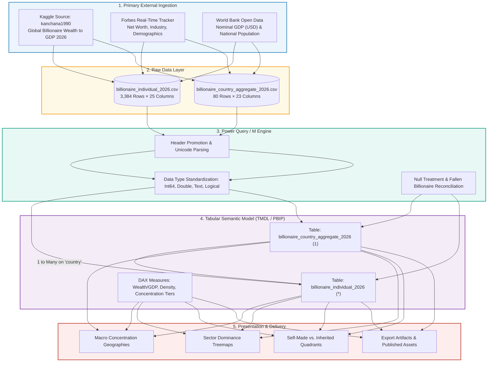
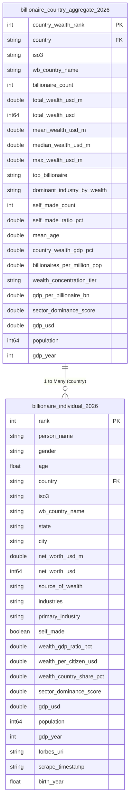
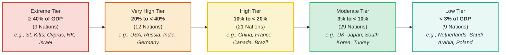

<div align="center">

# 🌐 Global Billionaire Wealth to GDP (2026)

### *Macroeconomic Exposure, Capital Concentration & Demographic Dynamics Across 3,384 Global Fortunes*

[](powerbi/Global_Billionaire_Wealth_2026.pbip)
[](powerbi/Global_Billionaire_Wealth_2026.SemanticModel/)
[](docs/business_questions.md)
[](.github/workflows/ci.yml)
[](https://www.kaggle.com/datasets/kanchana1990/global-billionaire-wealth-to-gdp-2026/data)
[](.github/workflows/ci.yml)
[](LICENSE)

<br/>

```
╔════════════════════════════════════════════════════════════════════════════════════════════════════════╗
║  📊 3,384 Billionaires  │  🌍 80 Sovereign Nations  │  💰 $19.64 Trillion Combined Wealth              ║
║  🔬 66.6% Self-Made     │  📈 29.0% US Wealth/GDP   │  💻 $4.75T Tech Sector Lead                      ║
╚════════════════════════════════════════════════════════════════════════════════════════════════════════╝
```

</div>

---

## 📑 Table of Contents

- [Executive Summary](#-executive-summary)
- [Key Macroeconomic & Wealth Findings](#-key-macroeconomic--wealth-findings)
- [Architecture & Data Pipeline](#-architecture--data-pipeline)
- [Data Model & Semantic Schema](#-data-model--semantic-schema)
- [Wealth Concentration Framework](#-wealth-concentration-framework)
- [Key DAX Measures & Metrics Catalog](#-key-dax-measures--metrics-catalog)
- [Repository Structure](#-repository-structure)
- [Dataset Specifications & Ingestion](#-dataset-specifications--ingestion)
- [Getting Started & Reproduction Guide](#-getting-started--reproduction-guide)
- [Documentation Suite](#-documentation-suite)
- [Contributing & Community](#-contributing--community)
- [Data Source Attribution & Citations](#-data-source-attribution--citations)

---

## 🌟 Executive Summary

The **Global Billionaire Wealth to GDP (2026)** analytics project investigates the structural scale, geographic distribution, and macroeconomic weight of ultra-high-net-worth capital across the globe. By fusing real-time net-worth disclosures with World Bank macroeconomic accounts, this project provides a granular lens into how private fortunes interface with sovereign economies.

> [!IMPORTANT]
> **Macroeconomic Context**: Total billionaire wealth tracked across the globe stands at **\$19.64 Trillion USD** distributed among **3,384 individuals** in **80 countries**. In several jurisdictions, the cumulative wealth of resident billionaires exceeds or rivals their nation's entire annual domestic output (GDP), introducing significant macroeconomic and fiscal considerations.

### 📌 Core Analytical Themes

1. **Macroeconomic Exposure**: Evaluating national vulnerability where billionaire assets exceed 20% to 40%+ of annual nominal GDP.
2. **Sovereign Capital Centers**: Analyzing geographic concentration across traditional powerhouses (United States, China, India, Germany) versus financial havens (Hong Kong, Singapore, Switzerland, Cyprus).
3. **Wealth Origin & Social Mobility**: Comparing entrepreneurial self-made capital formation against multi-generational dynastic inheritance across regional regimes.
4. **Sectoral Hegemony**: Dissecting technological capital accumulation against legacy industrial, financial, and retail sectors.

---

## 📊 Key Macroeconomic & Wealth Findings

<div align="center">

| Metric / Dimension | Global Benchmark | Top Sovereign Entity | Key Observation |
| :--- | :---: | :--- | :--- |
| **Total Net Worth** | **\$19,639,550 Million** | 🇺🇸 United States (\$8.34T) | US accounts for **42.5%** of all global billionaire wealth. |
| **Billionaire Headcount** | **3,384 Individuals** | 🇺🇸 United States (978) | Followed by 🇨🇳 China (528), 🇮🇳 India (225), 🇩🇪 Germany (212). |
| **Wealth-to-GDP Extreme** | **15.4% Global Median** | 🇰🇳 St. Kitts & Nevis (860.7%) | Driven by citizenship-by-investment crypto founders. |
| **Top Sovereign Wealth-to-GDP** | **30.1% (G20 Max)** | 🇷🇺 Russia (30.1%) / 🇺🇸 USA (29.0%) | High concentration in commodity extraction and tech conglomerates. |
| **Self-Made Proportion** | **66.6% (2,255)** | 🇨🇳 China (97.2%) | Rapid market transformation vs. European legacy dynasties (Germany: 26.9%). |
| **Leading Industry Sector** | **Technology (\$4.75T)** | 🇺🇸 Technology (468 tycoons) | Tech yields highest individual average valuation (\$10.16B). |
| **Gender Distribution** | **86.0% M / 14.0% F** | 🇫🇷 France (F: L'Oréal) | Female billionaires predominantly possess inherited family enterprises. |

</div>

```
Global Wealth Distribution by Primary Industry ($ Trillion USD)
═════════════════════════════════════════════════════════════════
Technology            ████████████████████████████████████  $4.75T (468)
Finance & Investments ███████████████████████              $3.17T (513)
Fashion & Retail      █████████████████                    $2.24T (301)
Manufacturing         ███████████                          $1.48T (455)
Diversified           ██████████                           $1.33T (229)
Food & Beverage       █████████                            $1.24T (253)
Healthcare            ███████                              $0.96T (251)
Real Estate           ██████                               $0.76T (211)
Energy                ██████                               $0.74T (113)
Metals & Mining       █████                                $0.69T (93)
```

---

## 🏗️ Architecture & Data Pipeline

The analytical solution follows a modern Business Intelligence engineering lifecycle, progressing from raw heterogeneous sources to a modular, version-controlled Power BI project (`.pbip`) powered by the Tabular Model Definition Language (TMDL).



---

## 📐 Data Model & Semantic Schema

The semantic layer implements a star/snowflake dimensional model optimized for interactive slicing across geography, economic sectors, wealth tiers, and biographical attributes.



> [!NOTE]
> **Developer Mode Advantage (`.pbip`)**: This repository utilizes the Power BI Project format. All semantic model objects are defined as plain-text `.tmdl` files under `powerbi/Global_Billionaire_Wealth_2026.SemanticModel/definition/`, making data model revisions transparent and trackable via Git diffs.

---

## 🎯 Wealth Concentration Framework

Nations in the semantic model are categorized into five macroeconomic exposure tiers based on aggregate billionaire wealth relative to annual nominal GDP:



- **Extreme ($\ge 40\%$)**: Small island tax regimes, special administrative territories, and high-density innovation hubs where private capital dwarfs domestic output.
- **Very High ($20\%\text{--}40\%$)**: Major global economic powers with massive domestic private corporate champions (Silicon Valley, German Mittelstand conglomerates, Russian natural resource syndicates).
- **High ($10\%\text{--}20\%$)**: Large diversified economies with balanced public-private corporate structures.
- **Moderate ($3\%\text{--}10\%$)**: Advanced OECD economies characterized by progressive tax structures, state participation, or distributed corporate ownership.
- **Low ($< 3\%$)**: Resource economies with sovereign wealth funds or emerging markets with nascent private capital formation.

---

## 📈 Key DAX Measures & Metrics Catalog

Below are key DAX formulas authored to drive analytical reporting and dynamic slicing:

### 1. Total Aggregate Billionaire Wealth
```dax
Total Billionaire Wealth ($M) = 
SUM(billionaire_individual_2026[net_worth_usd_m])
```

### 2. Weighted Wealth-to-GDP Concentration Ratio
```dax
Billionaire Wealth to GDP % = 
VAR TotalWealthUSD = SUM(billionaire_country_aggregate_2026[total_wealth_usd])
VAR NationalGDP = AVERAGE(billionaire_country_aggregate_2026[gdp_usd])
RETURN
    DIVIDE(TotalWealthUSD, NationalGDP, 0) * 100
```

### 3. Self-Made Entrepreneurial Proportion
```dax
Self-Made Ratio % = 
VAR TotalBillionaires = COUNTROWS(billionaire_individual_2026)
VAR SelfMadeBillionaires = 
    CALCULATE(
        COUNTROWS(billionaire_individual_2026),
        billionaire_individual_2026[self_made] = TRUE()
    )
RETURN
    DIVIDE(SelfMadeBillionaires, TotalBillionaires, 0) * 100
```

### 4. Per-Capita Billionaire Density
```dax
Billionaires Per Million Pop = 
VAR TotalCount = SUM(billionaire_country_aggregate_2026[billionaire_count])
VAR TotalPopulation = AVERAGE(billionaire_country_aggregate_2026[population])
RETURN
    DIVIDE(TotalCount, (TotalPopulation / 1000000), 0)
```

### 5. Top 1% Oligarch Concentration Index
```dax
Top 1% Wealth Share % = 
VAR TotalWealth = [Total Billionaire Wealth ($M)]
VAR Top1PercentCount = ROUNDUP(COUNTROWS(billionaire_individual_2026) * 0.01, 0)
VAR TopWealth = 
    CALCULATE(
        [Total Billionaire Wealth ($M)],
        TOPN(Top1PercentCount, ALLSELECTED(billionaire_individual_2026), billionaire_individual_2026[net_worth_usd_m], DESC)
    )
RETURN
    DIVIDE(TopWealth, TotalWealth, 0) * 100
```

---

## 📂 Repository Structure

```
Global-Billionaire-Wealth-2026/
├── .github/                                # GitHub automation & community templates
│   ├── ISSUE_TEMPLATE/                     # Custom issue templates
│   │   ├── bug_report.md                   # Bug & calculation error reporting
│   │   ├── config.yml                      # Template chooser configuration
│   │   ├── data_inquiry.md                 # Methodology & data inquiries
│   │   └── feature_request.md              # New visual & DAX proposals
│   ├── workflows/                          # GitHub Actions workflows
│   │   └── ci.yml                          # Schema validation & integrity CI
│   └── pull_request_template.md            # Structured PR review checklist
├── assets/                                 # Project graphics and diagram exports
│   └── mermaid-diagram.png                 # Pre-rendered architectural diagram
├── data/                                   # Data layer
│   └── raw/                                # Raw immutable source datasets
│       ├── billionaire_country_aggregate_2026.csv  # 80 countries aggregate metrics
│       └── billionaire_individual_2026.csv         # 3,384 individuals granular metrics
├── docs/                                   # Comprehensive documentation suite
│   ├── business_questions.md               # 8+ macroeconomic & business questions
│   ├── data_dictionary.md                  # Complete field glossary & business rules
│   ├── data_quality_log.md                 # Audit results & outlier handling
│   └── methodology_and_limitations.md      # Valuation formulas & economic constraints
├── exports/                                # Visual and publishing artifacts
│   ├── published_assets/                   # PDF / PowerPoint deck exports
│   └── report_screenshots/                 # High-resolution Power BI canvas captures
├── powerbi/                                # Microsoft Power BI Desktop Project (PBIP)
│   ├── .gitignore                          # PBIP local settings & ABF cache ignore
│   ├── Global_Billionaire_Wealth_2026.pbip # Main Power BI Project entrypoint
│   ├── Global_Billionaire_Wealth_2026.Report/       # Visual page definitions & layout
│   │   ├── definition.pbir                 # Report binding pointer
│   │   ├── definition/                     # Page metadata and visual JSONs
│   │   └── StaticResources/                # Custom themes & color palettes
│   └── Global_Billionaire_Wealth_2026.SemanticModel/ # Tabular semantic model
│       ├── definition.pbism                # Semantic model definition pointer
│       └── definition/                     # TMDL definition files
│           ├── database.tmdl               # Database compatibility
│           ├── model.tmdl                  # Model root annotations
│           ├── relationships.tmdl          # Star-schema entity relationships
│           └── tables/                     # TMDL table & M-query partitions
├── .gitattributes                          # Git LF normalization & TMDL diff rules
├── .gitignore                              # Comprehensive root ignore rules
├── CONTRIBUTING.md                         # Contributor guidelines & DAX standards
├── LICENSE                                 # MIT License
└── README.md                               # Project documentation homepage
```

---

## 💾 Dataset Specifications & Ingestion

### Raw Data Origin
- **Kaggle Repository**: [kanchana1990/global-billionaire-wealth-to-gdp-2026](https://www.kaggle.com/datasets/kanchana1990/global-billionaire-wealth-to-gdp-2026/data)
- **Primary Collectors**: Forbes Real-Time Wealth Index & The World Bank Group
- **Temporal Alignment**: Scraped on **April 10, 2026 at 21:32 UTC**; World Bank economic indicators align with **2023–2024 standardized accounts**.

### Schema Summary
1. **`billionaire_individual_2026.csv`**:
   - **Records**: 3,384 individual billionaires and prominent family holdings across 80 countries.
   - **Key Attributes**: Net worth (\$M and absolute USD), age, gender, primary industry, self-made status, wealth-to-GDP ratio, and per-citizen wealth equivalent.
2. **`billionaire_country_aggregate_2026.csv`**:
   - **Records**: 80 sovereign nations and autonomous economic territories.
   - **Key Attributes**: Total national wealth, mean/median wealth, dominant industry, self-made ratio, country wealth-to-GDP percentage, and wealth concentration tier.

---

## 🚀 Getting Started & Reproduction Guide

### Prerequisites
- [Power BI Desktop](https://powerbi.microsoft.com/desktop/) (Version 2.126.0+ with **Power BI Project (.pbip)** feature enabled)
- [Git](https://git-scm.com/) installed on your machine
- [Python 3.10+](https://www.python.org/) with `pandas` (optional, for local CI and audit scripts)

### Step-by-Step Setup

1. **Clone the Repository**:
   ```bash
   git clone https://github.com/<your-username>/Global-Billionaire-Wealth-2026.git
   cd Global-Billionaire-Wealth-2026
   ```

2. **Open the Power BI Project**:
   - Double-click `powerbi/Global_Billionaire_Wealth_2026.pbip` to launch Power BI Desktop.
   - The report automatically loads both tables via relative paths and binds the semantic model.

3. **Verify Data Refresh**:
   - In Power BI Desktop, click **Home** > **Refresh**.
   - Confirm that all 3,384 individual rows and 80 country aggregate rows populate without warnings.

4. **Run Data Integrity Audit via Python (Optional)**:
   ```bash
   python -c "
   import pandas as pd
   ind = pd.read_csv('data/raw/billionaire_individual_2026.csv')
   agg = pd.read_csv('data/raw/billionaire_country_aggregate_2026.csv')
   print(f'Individuals: {len(ind)} rows | Countries: {len(agg)} rows')
   print(f'Reconciliation Delta: {abs(ind[\"net_worth_usd_m\"].sum() - agg[\"total_wealth_usd_m\"].sum()):.4f}')
   "
   ```

---

## 📚 Documentation Suite

For comprehensive deep dives into analytical methodologies, data quality audits, and business inquiries, please consult the specialized guides in the [`docs/`](docs/) directory:

| Document | Description |
| :--- | :--- |
| 📖 [Data Dictionary](docs/data_dictionary.md) | Full column definitions, storage types, business logic, null rules, and example values. |
| ❓ [Business Questions](docs/business_questions.md) | Detailed analysis of macroeconomic exposure, sector dominance, demographic disparity, and oligarchy. |
| 🛡️ [Data Quality Log](docs/data_quality_log.md) | Audit logs, null resolutions (e.g. fallen billionaires), referential integrity, and outlier treatments. |
| 🔬 [Methodology & Limitations](docs/methodology_and_limitations.md) | Stock vs. flow economics, tax haven distortions, valuation methodologies, and survivorship bias. |

---

## 🤝 Contributing & Community

Contributions are welcomed! Whether you wish to propose new DAX measures, refine report visuals, or expand data transformations:

1. Review [CONTRIBUTING.md](CONTRIBUTING.md) for coding conventions, DAX formatting standards, and Git branch workflows.
2. Check existing [Issues](https://github.com/) or open a new [Bug Report](.github/ISSUE_TEMPLATE/bug_report.md) or [Feature Request](.github/ISSUE_TEMPLATE/feature_request.md).
3. Ensure automated CI passes before submitting your Pull Request.

---

## 📄 Data Source Attribution & Citations

- **Original Dataset**: Curated by **Kanchana1990** on [Kaggle: Global Billionaire Wealth to GDP (2026)](https://www.kaggle.com/datasets/kanchana1990/global-billionaire-wealth-to-gdp-2026/data).
- **Wealth Estimates**: Forbes Media LLC (Real-Time Billionaires Tracker).
- **Macroeconomic Data**: The World Bank Group (World Development Indicators: Current GDP & Total Population).

### Citation
```bibtex
@dataset{kanchana_billionaires_2026,
  author    = {Kanchana1990},
  title     = {Global Billionaire Wealth to GDP (2026)},
  year      = {2026},
  publisher = {Kaggle},
  url       = {https://www.kaggle.com/datasets/kanchana1990/global-billionaire-wealth-to-gdp-2026/data}
}
```

---

<div align="center">

**Designed with Power BI Developer Mode (PBIP) & Tabular Model Definition Language (TMDL)**

*Crafted for Data Analysts, Economists, and Business Intelligence Engineers.*

</div>
